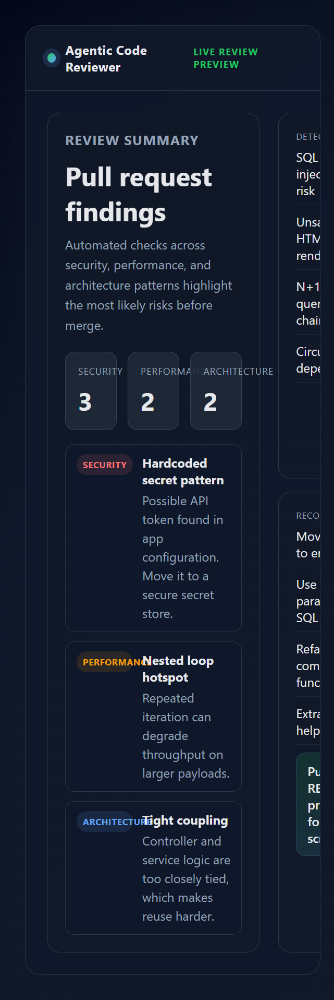

# Agentic Code Reviewer

A self-hosted GitHub PR review bot that catches risky changes before they ship.

[](https://www.typescriptlang.org/)
[](https://docs.github.com/en/webhooks)
[](https://jestjs.io/)
[](LICENSE)

> Problem: most teams review pull requests manually, but security issues, performance regressions, and architecture drift often slip through before merge. That means preventable bugs reach production, and review teams spend too much time on repetitive checks.

> Solution: Agentic Code Reviewer listens for GitHub pull request events, inspects the changed code, and posts actionable review feedback directly on the PR. It helps engineering teams catch common risks earlier without sending source code to a third-party SaaS.

⭐ If you find this useful, please:

- ⭐ Star the repo on GitHub
- 🍴 Fork it
- 💬 Leave feedback in issues

Stars, forks, and feedback help this project get discovered and make it easier to keep improving.

<p align="center">
  
</p>

## What it does

Agentic Code Reviewer analyzes incoming PR diffs and looks for patterns that commonly lead to:

- hardcoded secrets and insecure configuration
- SQL injection and unsafe input handling
- performance issues like expensive loops or repeated database access
- architecture smells like tight coupling or complex functions
- maintainability problems before they become technical debt

### Example use case

A developer opens a pull request that adds a new API client. The bot reviews the diff, detects a hardcoded token, warns about repeated DB queries, and leaves a review comment like:

```text
Possible hardcoded secret detected in src/config.ts
Suggestion: move the token to an environment variable or a secrets manager.
```

## Tech stack

- TypeScript
- Express.js
- PostgreSQL
- Redis + Bull
- GitHub Webhooks
- Jest
- LangChain / LLM integration hooks

## Features

- Pull request webhook validation with GitHub signatures
- Diff-based static analysis for security, performance, and architecture
- Review comments posted directly to GitHub pull requests
- Queue-based processing for background analysis jobs
- PostgreSQL persistence and health checks
- Configurable environment-based setup for local or self-hosted deployments

## How it works

1. GitHub sends a pull request webhook when a PR is opened or updated.
2. The server verifies the webhook signature and captures the diff.
3. The analyzer checks added code for known risky patterns.
4. Findings are queued and posted back to GitHub as Markdown review comments.

## Quick start

### Prerequisites

- Node.js 18+ recommended
- PostgreSQL 12+
- Redis 6+
- GitHub token with PR read/write access
- Public HTTPS URL for GitHub webhook delivery in production

### Install

```bash
git clone https://github.com/Srameshgitnow/agentic-code-reviewer.git
cd agentic-code-reviewer
npm install
cp .env.example .env
```

### Configure environment

```env
NODE_ENV=development
PORT=3000
WEBHOOK_PATH=/webhook
GITHUB_WEBHOOK_SECRET=your-webhook-secret
GITHUB_TOKEN=your-github-token
GITHUB_APP_ID=your-app-id

LLM_PROVIDER=claude
OPENAI_API_KEY=your-openai-api-key
ANTHROPIC_API_KEY=your-anthropic-api-key
CLAUDE_API_KEY=your-claude-key
LLM_MODEL=claude-3-5-sonnet-20241022

DB_HOST=localhost
DB_PORT=5432
DB_USER=postgres
DB_PASSWORD=postgres
DB_NAME=code_reviewer
REDIS_URL=redis://localhost:6379
LOG_LEVEL=info
```

> Keep real credentials in a local `.env` only. Never commit secrets or tokens to the repository.

### Run locally

```bash
npm run build
npm run dev
```

The app listens on port `3000` by default.

### Generate the demo preview

```bash
npm run demo
```

## Current scope

This project uses deterministic pattern-based analysis and rule heuristics. Findings are suggested review signals, not proof of a vulnerability, and should still be validated using your normal engineering and security workflows.

Supported language detection includes TypeScript, JavaScript, Python, Java, C#, Go, Ruby, PHP, SQL, HTML, CSS, JSON, and YAML.

## Project structure

```text
src/
├── index.ts                 Express server and webhook orchestration
├── github-webhook.ts        Signature verification and event parsing
├── github-api.ts            GitHub REST API client
├── code-analyzer.ts         Diff parsing and language detection
├── security-analyzer.ts     Security heuristics
├── performance-analyzer.ts  Performance heuristics
├── architecture-analyzer.ts Architecture heuristics
├── code-review-agent.ts     Review orchestration and Markdown output
├── queue.ts                 Redis/Bull job processing
├── database.ts              PostgreSQL persistence
├── demo.ts                  Demo preview generator
└── ...
```

## Development

```bash
npm test
npm run build
npm run lint
```

## Roadmap

- Add a local CLI mode for reviewing diffs without GitHub or external services
- Add Docker Compose for one-command local setup
- Improve analyzer rules and reduce false positives
- Add richer queue metrics and health reporting
- Add optional LLM-assisted explanations behind explicit opt-in

## Security

Never commit credentials, GitHub tokens, database passwords, webhook secrets, or `.env` files with real values. Report issues privately through the project's security contact rather than exposing them publicly.

## License

MIT. See [LICENSE](LICENSE).

## Support the project

If this project helps you, please:

- ⭐ [Star the repo on GitHub](https://github.com/Srameshgitnow/agentic-code-reviewer)
- 🍴 Fork it
- 💬 Leave feedback in issues

It helps more developers discover the repo and gives the project momentum for future improvements.

